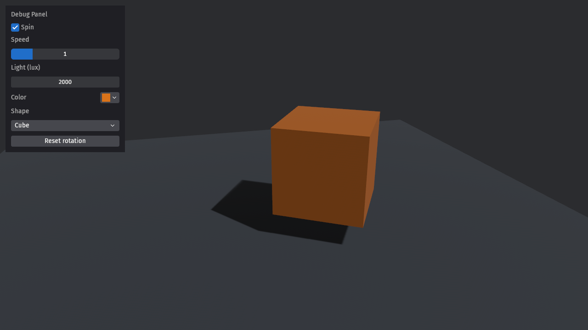

# bevy-feathers-tools-demo

用 Bevy Feathers 给 3D 场景做一块调试面板。这是一个最小 demo。

- **Bevy 版本**：`=0.20.0`（Cargo.toml 锁死版本，开 `bevy_feathers` 特性）
- Rust：在 rustc 1.99.1 下编译通过
- 用到的控件：Checkbox、Slider、NumberInput、ColorInput、Select、Button



## 运行

```sh
cargo run
```

Feathers 不在 Bevy 的默认特性里，必须手动开启：

```toml
bevy = { version = "=0.20.0", features = ["bevy_feathers"] }
```

## 自动截图

```sh
DEMO_SCREENSHOT=out.png cargo run   # 第 120 帧截图，第 180 帧退出
```

`DEMO_SHOT_FRAME` 和 `DEMO_EXIT_FRAME` 可以改截图帧和退出帧。在无显卡的 Linux 上可以这样跑：

```sh
xvfb-run -a -s "-screen 0 1280x720x24" env WGPU_BACKEND=vulkan DEMO_SCREENSHOT=out.png cargo run
```

这条命令走 Mesa llvmpipe 软件渲染。

## 注意

- Feathers 官方定位是给工具和编辑器用的 UI，不打算用于游戏 UI。
- 内置字体不含中文，中文标签会显示成方块。
- 0.17 和 0.18 的旧写法（`experimental_bevy_feathers` 特性加 spawn 函数）已经过时。0.19 起改用 BSN 写法。

参考：bevyengine/bevy v0.20.0 的 `examples/ui/widgets/feathers_*.rs`

## 交互实测（xdotool，Xvfb + llvmpipe）

- 滑条：Feathers 滑条默认 `TrackClick::Drag`，单击轨道不跳值，要按住拖。拖到 4.0：`screenshots/demo-slider-drag.png`（加了 `SliderPrecision(1)`，否则拖动显示 3.9661016）。
- 数字输入：按住左右拖，2000 → 2990：`screenshots/demo-number-drag.png`。
- 按钮：取消 Spin 后点 Reset rotation，立方体回到初始朝向：`screenshots/demo-reset-button.png`。
